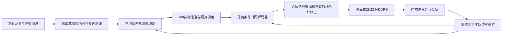

# 第五章工程接入：2026-11-13

两个网络已接到真实第三章任务，具备有限采集、标签、训练、恢复和评价流程。工程闭环与论文性能结论分别验收。

## 固定底座

工程使用 `configs/b2.json` 的 `D2_B2_repair_v2` MADDPG：4艇×28维输入、连续3维残差动作、gamma=.95。父配置SHA-256为 `41e46d4d9ae35f7808d3bb82ae859f83117580013f8c2e69d93f4b83203dce48`，父来源身份在 `provenance/ch3_parent_snapshot.json`，不因本次接入重写。

四艇地图复用第三章 `OnlineUnknownMapTaskPlanner`，并非自动选定了有界v3最终方法。`core`、`chapter3_bser`保持字节不变；原400步期限、目标运动、扰动、物理积分、捕获/碰撞/成功判据和奖励公式继续使用继承实现与 `Phase1CV2TrainingEnv + PRRACTrainingEnv` 包装。32步是外部计算预算截断，不改写环境done，不产生虚构失败或完整任务成功率。

## 通信可见性的演化

原即时全局地图、免费固定交接、全局Found控制掩码由CH5适配器替换。各艇独立维护地图、接收历史和阶段；规划、导航、动作掩码只使用自身测量及实际收包。障碍距离裁剪到本地传感范围。输入维数与物理含义沿用父接口，可见性按通信问题调整；不能宣称新轨迹与原即时共享行为完全等价。

协调器位于既有Searcher0，没有第五个节点。未收到目标的Executor在自身初始点驻留，不免费读取全队待机规划。目标、队友状态、扫描、查询、Found信息、规划命令、ACK均经同一TDMA信道。发送者和接收者采用固定轮转；目前通信Actor只学习包槽位/NOOP。

真实16字节报头＋32字节int8载荷=384bit。`TARGET_LATENT`报文类型表示发送者已有合法目标证据；该信息在实际计费报头内，收包仍不能凭预测创建发现、known或交接。链路含共享声学串行队列、传播、延迟、丢包和连续中断。原始报文和ACK同样按实际字节扣费。



## 标签与学习契约

每一实际物理步记录目标位置/速度，独立存入训练侧事实。部署输入不读未来目标或truth地图。每次真实神经收包保存源特征、实际包槽、信息年龄、接收方局部几何及局部候选路线。标签用第三章扫掠距离内核，将已保存的路线预测与后来真实发生的目标轨迹比较，使用各艇原搜索半径/执行捕获半径。这是几何相遇标签，不是反事实完整任务成功标签。

未来不足、预测不足及episode边界不补假负例；已经观察到的正例保留。状态监督用实际时刻的位置和速度，仅对发送源有目标证据且实际收到动态包的样本启用；无有效监督明确跳过。静态地图token使用占据与观测置信，不把动态目标信念塞入静态流。

辅助学习更新编码器、解码器、路线头，分别记录路线/状态/时间损失。当前采用单包预训练，部署可组合多个已收包缓存，尚未实现缓存级精确重放。

随后复用第三章MADDPG回放，使用未加工的原任务reward。下一观测对齐下一次收包/解码后的实际决策状态；外部截断末尾未对齐的一条transition保留记录但不入replay。冻结codec/decoder/任务Actor后，在新episode训练通信SMDP A2C：收益为原任务reward按真实物理步折扣累积，每episode更新一次，拒绝旧策略版本复用。未到下一决策点的末尾区间明确删失。未添加人工通信评分奖励，未实现CVaR/DRO。

采集含原生成器seed699近距机制场景和seed67431普通场景。699初始Searcher0距目标约0.965米，场景、任务、传感器和目标运动均原样生成；选择它只为在短预算覆盖实际目标消息与状态监督。普通评价seed97431独立保留，不根据结果筛选。分层采集不能证明平均性能。

## 命令和产物

在本项目目录使用AUV环境CPU：

```powershell
D:/anaconda/anaconda/envs/AUV/python.exe -B cli.py ch5 plan
D:/anaconda/anaconda/envs/AUV/python.exe -B cli.py ch5 smoke --execute --output outputs/chapter5/fresh_run
D:/anaconda/anaconda/envs/AUV/python.exe -B cli.py ch5 collect --execute --output outputs/chapter5/fresh_collect
D:/anaconda/anaconda/envs/AUV/python.exe -B cli.py ch5 labels --execute --dataset outputs/chapter5/fresh_collect/episode_0/factual_trajectory.jsonl --output outputs/chapter5/fresh_labels
D:/anaconda/anaconda/envs/AUV/python.exe -B cli.py ch5 evaluate --execute --checkpoint outputs/chapter5/fresh_run/checkpoint.pt --output outputs/chapter5/fresh_eval
```

`plan`不执行；`--execute`显式启动受硬上限约束的流程，`train`也保持相同上限，未开放自动长训练入口。`smoke`依次采集2个episode、辅助4次/MADDPG4次更新、通信新episode2个/A2C2次更新、检查点恢复、learned/fixed各2个评价episode。每个最多32步，真实终止则提前结束。输出必须为全新目录，拒绝覆盖，失败记录保留。

各episode输出事实JSONL、标签、通信事件、实际收包、任务transition及summary；总目录记录配置、场景、训练历史、检查点SHA/源码身份、恢复一致性和report。新检查点支持恢复到新episode；不声称恢复活动环境或replay。未加载历史权重。

运行证据见 `CH5_SHORT_TEST_RESULTS_20261113.md` 与对应 `report.json`。字节保全及创建文件记录在workspace的 `PHASE0A_AUDIT/reports/CH5_integration_20261113`。

## 正式实验边界

仍需多独立训练种子、完整400步任务评价、相同故障/字节预算基线、独立训练的编码/解码/时间补偿消融、未见故障强度扫描、状态误差与校准、计算开销及置信区间。当前同seed的链路RNG会随发送决策消耗不同随机数，不宣称逐包相同故障轨迹或统计显著提升。最终创新是否达到参考论文的证据强度仍为REVIEW_REQUIRED。
