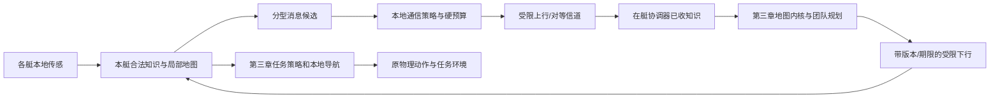

# 第五章重设计：面向异步地图与目标信息的任务驱动鲁棒通信强化学习

版本：v2，2026-11-13。状态：**研究设计，尚未实现或实验验证**。适用范围：博士论文第五章，继承第三章选定的强化学习、地图/目标估计和规划底座；排除德国论文/TUM/BVPC。

**后续修订：用户要求把主要创新落实为新网络模块。当前算法主线以 [v3网络设计](CH5_NEURAL_MODULES_V3_20261113.md) 为准，本文件继续提供全通道权限、协议和系统约束。v3的神经原型不代表本文件的环境/协议已实施。**

## 1. 重新确定研究对象与贡献边界

用户已明确：**目标信息、队友状态、地图共享全部受限**。因此，中央规划给出的航点、路径、任务分配和阶段指令，以及ACK、重传、转发，也必须经过通信或来自接收者合法本地推断。不能留下可靠共享地图、全局Found或真实队友状态的旁路。

研究问题是：在异构搜索—交接—执行任务中，不同节点持有不同且过期的地图、目标与队友认知，如何在有限通信资源下选择和利用信息，保持协同任务性能？物理任务、目标运动、传感器能力、奖励公式、碰撞与成功判据沿用第三章选定版本。信息分发与控制协议是第五章的显式演进，不声称与第三章即时共享行为等价。

建议以**两项核心方法＋一项标准风险训练变体**组织。暂用工程标识 `ch5_async_semantic_comm_v2`，不靠命名宣称原创：

1. **分型、来源可追溯的异步地图—目标接收信念**：在第三章耦合估计内核之上，处理不同类型信息的采样时间、重复来源和缺失，形成可供规划和策略使用的本地知识。
2. **跨语义、交付链感知的任务通信强化学习**：地图、目标、队友和控制消息竞争同一预算，通过真实任务回报学习消息选择，并覆盖上行到规划再到下行执行的延迟信用。
3. **连续任务回报的尾部风险训练**：使用规范的CVaR变体增强严重故障表现。CVaR、SMDP、PPO/A2C均为采用工具，不分别包装成首创。

这是一组可证伪的贡献候选。全通道受限、信息合法、换一个神经评分器、使用RNN或写出min-max，都不足以单独证明原创。最终贡献文字取决于实现、近邻比较和实验。

## 2. 文献使哪些旧主张必须收窄

本次公开文献集见 `CH5-Research/references/literature_20261113`，包含15份已下载PDF；另列合法全文未取得或仅可读官方HTML的近邻，状态分开记录。

| 近邻 | 已有内容 | 本项目必须进一步回答的问题 |
|---|---|---|
| VIL2C，AAAI2026，[官方PDF](https://ojs.aaai.org/index.php/AAAI/article/download/40234/44195) | VoI、延迟、资源分配与渐进接收 | 地图和目标不同时间语义、上/下行链路、实际任务损失与共同预算 |
| CoDe，AAAI2025，[官方PDF](https://ojs.aaai.org/index.php/AAAI/article/download/34497/36652) | 意图与时效双对齐的异步消息融合 | 静态证据不能统一按年龄衰减；目标负观测不能当作当前观测 |
| VA-MARO，2026，作者注明IROS接收，[原文](https://arxiv.org/abs/2607.17914) | 优势加权预测，补缺失队友观测 | 地图、目标、队友多类信息及连续中断、乱序、预算耦合 |
| CATMiP，RAS2025，[原文](https://arxiv.org/abs/2410.06372) | 异构探索/救援、局部地图、间歇通信和异步MARL | 3D连续运动、移动目标、全链数据权限与具体迟到证据处理；不能仅以任务组合称新 |
| Task-driven map sharing，[原文](https://arxiv.org/abs/2403.14780) | 为执行机器人传任务相关压缩地图 | 故障交付下的证据来源、动态目标时间对齐及通信策略学习 |
| SeqComm-DFL，2026预印本，[原文](https://arxiv.org/abs/2604.08944) | 直接以接收者决策价值学习顺序通信 | 泛称“决策价值驱动通信”不够，需要本项目的分型证据与交付链机制 |
| CMVC，TSMC2025，[DOI](https://doi.org/10.1109/TSMC.2025.3604230) | 反事实消息价值为明确近邻 | 本次未取得合法完整PDF，方法细节与可复现性为REVIEW_REQUIRED；不把Q差本身列为新颖点 |

参考DHG2Comm的扎实程度应落实为明确模型、具体机制、训练目标、可核验证据和合理外部对照。其第五章的多场景/五种子组织可借鉴；它自身缺少系统故障扫描及逐模块消融，也不能作为无条件的充分标准。

## 3. 系统结构：保留第三章规划，消除隐形共享

### 3.1 四艇与在艇协调器

保持原四艇。首版在一艘既有Searcher上托管固定协调器，身份预先配置；不增加第5艘艇、免费岸基节点或动态无代价选举。协调器使用同一主机的本地传感与收到的消息运行第三章团队规划；其他艇必须收到带版本和期限的指令才执行。

这是**受限通信下的在艇协调架构**，不称全分布式规划。选择它是为了固定规划组织，优先归因通信机制；完全分布式协商作为后续扩展。

传感到本艇知识是本地计算；跨艇信息全部经信道。中央规划不能读取环境里的全队真实位置、唯一共享地图或实时目标真值。仿真真值只用于物理演化、任务判据、离线指标与CTDE训练critic。

### 3.2 信息契约

定义节点i在时刻t的合法信息：

\[
\mathcal I_i^t=\sigma(o_i^{0:t},u_i^{0:t-1},\widetilde M_{*:i}^{0:t},\mathcal P),
\]

其中只包含实际送达的消息，\(\mathcal P\)为预共享角色、坐标系、模型与时隙规则等任务元数据，不包含真实地图、目标或队友实时状态。Actor、规划、phase、action mask和fallback都必须是该信息的函数。协调器也遵守其所在节点的信息边界。

起步假设沿用仿真共同坐标框架、已知本艇定位和共同计时基准，不另做SLAM或水声时钟同步。未收到的队友状态使用未知/先验表示，不能在reset偷填真值。若允许公共初始部署状态，应在所有对照中明确一致，不能延伸成持续可靠状态共享。

消息至少记录：类型、origin-agent、原始观测ID/片段ID、采样时间、发送时间、接收者、序号、有效期限、置信/量化信息和真实序列化字节数。重传和转发保留原观测ID及采样时间，不刷新证据年龄。

## 4. 核心方法一：分型异步接收信念

每艇维护 \(K_i=(G_i,B_i^{tar},B_i^{peer},\ell_i,q_i)\)：局部几何、目标信念、队友预测、已见证据账本和本地任务阶段/指令。协调器使用同类结构。

### 4.1 静态几何：迟到可用、重复不可再计

交换带来源的原始扫描/体素证据增量，避免直接交换并反复融合已经含共祖信息的后验。原始扫描拆成片段时，ID包含片段或patch标识；不能仅用新的发送包ID去重，也不能用单一sender最大序号拒绝所有更小但未见过的地图片段。

接收端从唯一已接受证据集合构造占据log-odds：

\[
L_i(v)=\operatorname{clip}\!\left(L_0(v)+\sum_{e\in\mathcal E_i(v)}\Delta L_e(v)\right).
\]

采用固定顺序累计后裁剪或每源累计分量，避免每次到达即裁剪造成融合顺序依赖。静态几何不因年龄本身自动失效，但受空间一致性、量化和来源检查限制。去重只解决同一原始证据的重复计入，不宣称消除不同扫描的全部相关性。

动态回放窗口W与几何证据账本分开。W可从第三章已有64步候选起步，比较32/64/128；去重ID可保留一整个有限回合或用明确的分片水印压缩。不能把只限定W说成全系统恒定内存，不能提前丢掉账本后又把旧重传算成新证据。

### 4.2 移动目标：按采样时刻更新，再传播到现在

正目标观测与真实未发现观测在各自采样时刻作用于目标信念，随后使用第三章运动/地图假设传播。迟到位置不能当作当前位置，迟到未发现不能直接排除当前目标区域。**未收到目标消息不等于未发现目标**，不能据此生成负观测。

窗口内迟到事件按确定次序插入，重放本地已知的观测和预测，复用第三章几何/粒子计算内核。缺失步仅预测，不伪造全队扫描。重放发生在当前接收后，不追改过去实际动作。

窗口外目标正/负信息采用预先定义的丢弃或保守近似，单独计数。其静态几何分量仍可融合。不声称有限窗口等于完整历史精确后验。若第三章目标反射依赖地图假设，迟到几何信息与目标历史需在同一窗口中重新计算，避免两套信念不一致。

### 4.3 队友与指令：保留不确定性，按本地知识执行

队友状态可从旧恒速/意图外推起步，使用采样年龄和预测置信；它是合法基线和工具，不是实时避碰保证。未知状态必须显式mask。

收到的路径、航点和STOP/phase带计划版本、生成时间及失效条件；本艇在自己的局部地图上检查可执行性。未获知Found的艇不因环境全局Found自动停止；Finder本地知情，其他艇在收到合法通知后切换。即使物理动作结束，通信进程仍运行。

局部传感器在全局首次发现后仍可按原能力产生本地测量；原代码的全局Found后停止检测属于需显式演进的信息控制逻辑。传感范围、噪声、目标运动和成功定义不因此改写。

### 4.4 可检验贡献

新颖性候选落在**耦合地图—移动目标估计如何接收不同时间语义与来源的证据，并影响任务决策**。ID、时间戳、OOSM和贝叶斯递推是采用工具。必须比较分型更新与统一年龄规则、迟到丢弃、无去重等合法简化版本，证明收益发生在地图/目标认知和任务链上。

## 5. 核心方法二：跨语义交付链通信强化学习

### 5.1 候选消息和资源

候选包括GEO_PATCH、TARGET_POS/NEG、STATE_INTENT、ASSIGN/ROUTE/PHASE及ACK/摘要。地图候选以影响路线可达性、目标传播假设的局部证据为主；不能把“新增体素多”直接当任务价值。目标与队友候选显式携带年龄、剩余任务时间和预测不确定性。

使用预共享TDMA发送机会。轮到的发送者从自己的合法候选中选择消息、接收者、片段/组合或NOOP。它不能读取全队实时评分后做免费全局排序。物理MAC只执行时隙、收发忙碌和碰撞规则，不替策略查看隐藏语义。

每个节点有硬token/airtime预算：

\[
c(S_t)\le b_t,\qquad b_{t+1}=\min(b_{max},b_t+\rho_t)-c(S_t).
\]

计费包含header、payload、重传、ACK、上下行和转发；广播按物理发送一次计费，逐接收者成功交付另记。不能用张量维度替代实际编码字节。传播、序列化、排队与处理均消耗原物理时钟，任务不为等待消息暂停。

信道用实际仿真几何产生丢包/延迟属于环境计算；发送策略只能从自己的测量、账本和收到的ACK估计链路，不能免费读真实全队距离/当前信道。旧有效声速、码率和仿真单位要校准，不把旧归一化参数直接声称为真实水声参数。

### 5.2 学什么，以及为什么不用即时Q差主监督

通信策略

\[
c_k\sim\mu_\phi(c\mid\mathcal I_i^{t_k},\mathcal C_i^{t_k},b_i^{t_k})
\]

接收分型知识摘要、候选集合、预计交付年龄、剩余期限、路线上下文与预算。在一个时隙可顺序选择多个可行片段时，选择器看到自己的已选集合，学习不同语义信息的替代/互补关系。候选集编码、注意力和RNN只是结构选择；实验需确认优于同预算独立评分与年龄优先。

发送者对接收者知识的代理，只能从已收到ACK、摘要和自身发送历史估计。没有ACK就保持交付不确定。对方真实地图、phase和收包集合只可作为训练/诊断oracle，不能进部署输入。

地图上传刚到协调器时，物理动作可能尚未改变；需要等到重规划和下行指令送达。因此，接收当步动作Q差可能为零，不能据此把上行地图判成无价值。CMVC和SeqComm-DFL已使通用反事实/决策价值不是空白；本章不依赖不存在的完整环境分支快照做主训练。

### 5.3 可实行的主训练：先固定任务Actor，再学通信

**阶段A：共同任务策略。** 在统一合法信息协议和固定普通通信下，按选定第三章算法建立每训练种子对应的任务Actor。第三章检查点只作明确验证的初始化候选，旧28维或139维权重不自动兼容新信息语义。该共同成本单独记录，全部通信方法公平共享或匹配。

**阶段B：冻结任务Actor，训练通信策略。** 任务Actor、地图数值内核和规划参数固定，通信策略改变它们未来可用的信息。通信编码器独立，或对共享trunk detach；用新鲜on-policy数据训练离散通信Actor–Critic。该阶段本身就是通信强化学习，不要求重做物理控制网络。

通信决策发生在物理时刻 \(t_k\)，间隔 \(\Delta_k\)。均值版本使用SMDP目标：

\[
R_k=\sum_{n=0}^{\Delta_k-1}\gamma^n r_{t_k+n},\qquad
y_k=R_k+\gamma^{\Delta_k}(1-d_k)V_\psi(X_{k+1}).
\]

\(r\)是原任务奖励，\(\gamma\)沿用第三章并按物理步计算，不按包数计算。训练状态X包含物理状态、各节点合法知识、在途包、预算、时隙和剩余时间；仅有物理真值不足以描述通信过程。CTDE critic可以有额外信息，通信Actor仅用自己的合法历史。

通信PPO/A2C独立维护事件轨迹、可行mask、动作、log-prob、原奖励区间及策略版本。不能把离散选择直接塞进现有MADDPG连续动作梯度，也不能混用固定28/3的旧replay。

**阶段C：可选交替联合适应。** 固定通信版本，用新数据更新任务Actor；再固定任务Actor，用新鲜轨迹更新通信策略。记录版本和额外预算，作为扩展实验。首版不声称端到端联合最优或保证交替收敛。

## 6. 风险训练：规范CVaR变体，不再硬贴DRO

主均值版本先闭环。风险版本对**固定任务Actor**的通信策略优化连续原任务回报G：

\[
\max_{\phi,\eta}\ (1-\lambda)\mathbb E[G]
 +\lambda\left(\eta-\frac1\alpha\mathbb E[(\eta-G)_+]\right).
\]

采用完整回合效用

\[
U_\eta(G)=(1-\lambda)G-\frac{\lambda}{\alpha}(\eta-G)_+
\]

的on-policy score-function梯度，或严格遵循已有风险策略梯度推导。对固定η，\(\nabla_\phi J=\mathbb E[U_\eta(G)\sum_k\nabla_\phi\log\mu_\phi(c_k\mid h_k)]\)，可减去不依赖当前动作的合法baseline；η按分位目标更新。PPO均值优势随便乘尾部权重不自动等于该目标的梯度。[标准风险策略梯度依据](https://arxiv.org/abs/1502.03919)。

成功率是独立指标，不能用二值成功替换连续G后声称得到了有效尾部学习。α、λ、有效尾部样本量和均值损失需报告；例如α=0.2时每批只有几个尾部回合会很不稳定。原γ可能削弱长链路信用，先诊断回报和交接成功关系，不悄悄修改γ或奖励来制造效果。

固定或分层匹配物理场景，分开通信故障与环境难度；否则尾部可能只是最难地图。CVaR提高而任务成功下降时，不能宣称任务鲁棒性提高。本章不承诺对所有信道分布的最坏保证，严格分布球DRO退出首版主线。

## 7. 理论与机制验证承诺

### 性质A：信息闭包与证据幂等性

在本地传感、实际送达事件、可测本地更新、协调器受限输入和下行条件下，可按时间归纳证明Actor/规划/fallback对 \(\mathcal I_i^t\) 可测。对相同唯一静态证据集合，若采用确定次序累计及明确裁剪，则重复重传/转发不改变结果，网络到达顺序不改变该静态合并结果。

条件必须明确：同一保留证据集、相同先验和数值规则；动态滤波还涉及窗口边界、排序与RNG，不能据此声称所有粒子后验在任意迟到条件下完全相同。该性质用于支撑机制正确性，不单独充当重大理论创新。

### 性质B：有限候选中的价值近似误差（可选）

在固定策略、固定候选集和有限决策模型下，若所有可行消息集合的估计效用误差统一不超过ε，且集合求解误差不超过εopt，则估计最优集合相对真实最优集合的效用损失不超过 \(2\epsilon+\epsilon_{opt}\)。这是条件性的决策误差分解，可用于组织belief、投递和价值误差诊断，不是神经网络获得该ε或真实任务全局最优的保证。

不预先承诺未证明的最坏通信保证、全局收敛或“越多消息越好”。消息可过期、占预算并挤占更关键消息，效用不必单调或次模，不能无条件套贪心近似比。

## 8. 达到参考论文同等扎实程度的证据要求

详见 `CH5_EXPERIMENT_PLAN_20261113.md`。核心不是凑相同图表数量：

- 两个核心方法均有具体接口、训练或估计步骤、独立消融及能解释提升的机制指标。
- 全部基线运行在同一新协议、任务判据、故障分布和预算下；第三章理想共享结果单列为参考，不能直接当配对新基线。
- 原始逐回合表可追溯到源码、配置、checkpoint、场景和通信轨迹；缺失旧表不拿其他批次代替。
- 建议正式核心组5个独立训练种子，先用3个种子检查稳定性；测试用固定独立场景，数量按区间精度与计算预算预先确定。种子数不是普遍学位门槛。
- 对照CoDe/VA-MARO/VIL2C等最接近机制，适配内容如实披露，不把缺代码的方法写成已复现。
- 若合法固定预测或简单年龄/阶段规则达到同等表现，应收缩对应学习创新，而不是继续堆网络模块。

## 9. 实施顺序和收缩条件

1. 冻结第三章算法/地图、任务及源码身份；没有唯一默认已通过性能验收的Active算法。
2. 完成全通道受限协议、预算和旁路检验；先固定普通通信闭环。
3. 实现分型接收信念，完成重复、迟到、乱序和断联的确定性小例子。
4. 建立共同任务Actor与均值SMDP通信学习；不用未实现的全系统反事实快照作前置。
5. 做机制与强基线对照，再增加规范风险训练；交替任务适应和完全分布式规划后置。

分型信念在相关故障下没有收益则缩小其性能主张，保留必要正确性；学习调度不优于简单规则则不认定为主要算法贡献；风险训练无稳定尾部任务收益则移出完整主方法。严格DRO、ER-HGC/ECHB、免费全局hint和拓扑堆叠从本版主线退出，但历史源码、权重和实验均保留。

本次只改变研究设计与文档，不改运行时、不训练、不删除历史数据。用户选择的全通道约束会在后续实施中产生明确协议演进，不能将当前继承运行代码描述为已经满足该约束。
